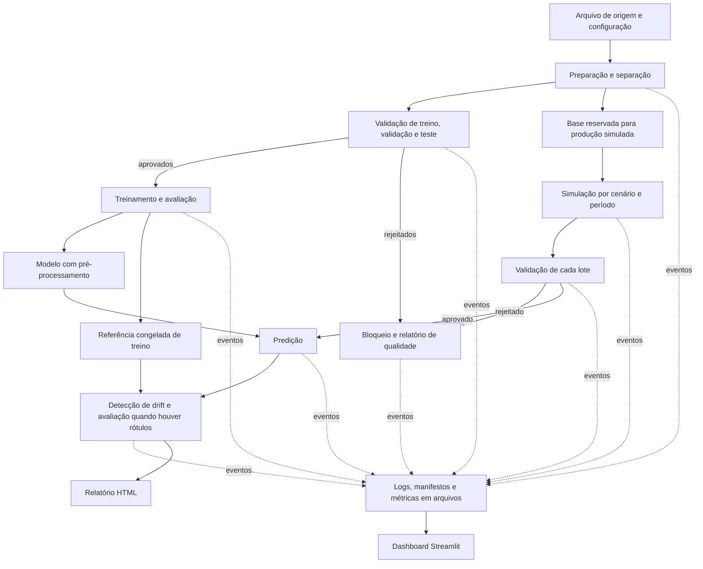

# Arquitetura e contratos entre componentes

## Estado e escopo

No escopo do PR #32 estão implementados a preparação e separação de dados
(F1-01), o treinamento baseline (F1-02) e a validação Pandera antes do treino
(F1-03). Predição F2-02 também está implementada, condicionada à validação
de produção. Detecção de drift e dashboard seguem
planejados e não devem ser tratados como comandos disponíveis. Testes sintéticos
cobrem a integração preparação → validação → treinamento; resultados históricos
do dataset real não foram reexecutados como parte do PR #32.

O PR #33 acrescenta `lote_invalido.py` para demonstrar a rejeição pelo contrato
de referência. Ele gera partições com seis anomalias intencionais a partir da
base de simulação, preserva destinos existentes e registra falhas de execução.
Aceita apenas `reference` com `train`, `validation` e `test`; a simulação de
produção com artefato `features` continua fora desse componente.

O PR #34 implementa a simulação temporal de Data Drift (F2-01) em
`simulacao/data_drift/`: consome a base reservada, exige avanço temporal positivo
e alteração efetiva da distribuição de pelo menos duas features, preserva
ausências e rejeita valores numéricos inválidos. Publica features e rótulos
separados, com parâmetros e alterações efetivas no manifesto.

O pacote `simulacao/data_drift/` separa configuração (`config.py`),
transformações sem escrita em disco (`transformacoes.py`), leitura e
representações dos artefatos (`artefatos.py`), orquestração (`servico.py`) e
linha de comando (`cli.py`). Hashes e escrita JSON ficam em
`infraestrutura/arquivos.py`; timestamps e eventos JSONL ficam em
`infraestrutura/observabilidade.py`. O comando é `uv run simular-data-drift`.

O pacote `drift/deteccao/` separa configuração, entradas, regras, resultados,
serviço e CLI. A integração com o Evidently fica em `adaptador_evidently.py`;
a leitura e seleção de features ficam em `drift/dados.py`. As regras de
decisão não importam o Evidently. O comando é `uv run detectar-drift`.
O adaptador calcula estatísticas; `relatorio.py` apresenta o documento canônico
em HTML customizado. JSON, HTML, métricas e alertas compartilham as mesmas
regras e os mesmos limiares. A detecção exige SHA-256 válido das três entradas
e cobertura de todas as features declaradas nos metadados. Colunas inteiramente
nulas recebem resultado indisponível e ficam fora do denominador; nenhuma
feature avaliável implica falha controlada. `changed_variables.not_evaluated`
distingue indisponibilidade de ausência de drift.

A reserva do diretório é exclusiva dentro do serviço. A detecção publica o
manifesto atomicamente e por último, após os eventos finais; falhas publicam
manifesto terminal `failed`, quando o armazenamento permite. Consumidores só
reconhecem sucesso quando manifesto e eventos finais correspondem à mesma
execução e etapa; a ausência de `drift_alert` exigido pelo resumo também
caracteriza publicação incompleta.

A arquitetura é um pipeline local em lote, com Python 3.12, uv, arquivos como
interface e dashboard Streamlit. As dependências incluem pandas,
scikit-learn, Pandera e Evidently.

## Fluxo e responsabilidades

| Componente em `src/monitoramento/` | Estado e responsabilidade | Consome | Produz |
| --- | --- | --- | --- |
| `preparacao.py` | Ler a fonte autorizada, executar transformações determinísticas e separar partições | Arquivo de origem e configuração do dataset | Treino, validação, teste, base de simulação e manifesto de preparação |
| `validacao.py` | Aplicar o contrato Pandera e bloquear o conjunto inteiro quando inválido | Manifesto do conjunto e versão do contrato | Relatório de qualidade e manifesto de aprovação ou rejeição |
| `treinamento.py` | Ajustar pré-processamento e classificador no treino; selecionar pela validação; avaliar no teste após seleção | Partições aprovadas e configuração do modelo | Pipeline serializado, metadados, métricas de avaliação e referência |
| `simulacao/data_drift/` | Produzir lotes independentes, com cenário de controle e mudanças configuradas | Base de simulação, cenário e seed | Lotes por período e manifesto de cada cenário |
| `simulacao/concept_drift/` | Gerar cenário de Concept Drift alterando a relação entre perfil e desfecho de um segmento, mantendo as features | Base de simulação, segmento e regra de mudança | Features inalteradas, rótulos do novo conceito, rótulos originais e manifesto do cenário |
| `predicao/` | Aplicar o mesmo pipeline do treinamento | Manifestos de treinamento, simulacao e validacao de producao | Predições e manifesto com vínculos ao modelo e lote |
| `drift/deteccao/` | Comparar referência e lote com Evidently; avaliar desempenho somente com rótulos compatíveis | Referência, lote aprovado, predições e configuração de detecção | Resultados estatísticos, alertas e HTML |
| `drift/analise/` | Aplicar PSI e Kolmogorov-Smirnov por variável e interpretar o drift | Referência e lote simulado | Resultados por variável, cruzamento com as variáveis alteradas e conclusões técnicas |
| `avaliacao/concept_drift/` | Comparar o desempenho do modelo entre o conceito original e o cenário de Concept Drift | Modelo e referência do treinamento e lote de Concept Drift | Métricas por conceito, comparação e interpretação em `performance.json` |
| `observabilidade/logs/` | Consolidar os eventos de todas as execuções em um log operacional único | `events.jsonl` e manifestos das execuções | Log consolidado (`operacional.jsonl`) e resumo com contagens, falhas e alertas (`resumo.json`) |
| `observabilidade/metricas_saude/` | Coletar as métricas de saúde operacional do catálogo a partir dos artefatos persistidos | Manifestos, `metrics.json`, `quality.json`, `drift.json`, `analise.json`, `performance.json` e catálogo | Medidas por execução e agregados com disponibilidade e situação (`saude.json`) |
| `alertas.py` | Integrar logs, métricas de saúde e resultados de drift; sinalizar falhas e degradação | `reports/saude/saude.json`, `reports/logs/resumo.json` e catálogo de alertas | Alertas classificáveis e contáveis, bloco consolidado de drift e resumo (`alertas.json`) |
| `dashboard.py` | Apresentar execuções e resultados persistidos, inclusive falhas | Manifestos, eventos, métricas agregadas e relatórios | Visualização Streamlit; sem iniciar treino ou alterar os dados |

A validação se aplica antes de qualquer ajuste ou predição. A preparação não
aprende imputação, escalas, codificações ou seleção de variáveis a partir do
conjunto completo. Se não puder ler ou separar a origem com segurança, deve
falhar e registrar o erro, sem gerar aprovação implícita.

## Separação dos dados e prevenção de vazamento

| Papel | Caminho futuro | Uso permitido |
| --- | --- | --- |
| Treino | `data/reference/<preparation_id>/train.csv` | Ajuste do pipeline e origem da referência estatística |
| Validação | `data/reference/<preparation_id>/validation.csv` | Seleção do modelo; sem ajuste do pré-processamento |
| Teste | `data/reference/<preparation_id>/test.csv` | Avaliação final, após a seleção |
| Referência de drift | `data/reference/<reference_id>/features.csv` | Cópia congelada das features de treino na representação de entrada do modelo |
| Base de simulação | `data/analysis/<preparation_id>/simulation_base.csv` | Origem reservada dos cenários; fora de treino, validação e teste |
| Produção simulada | `data/analysis/<scenario_id>/<batch_id>/features.csv` | Validação, predição e comparação com a referência |
| Rótulos de produção, quando disponíveis | `data/analysis/<scenario_id>/<batch_id>/labels.csv` | Avaliação posterior; não entram como features |

As quatro partições devem ser disjuntas. A configuração atual usa corte
temporal por `issue_d`, seed 42 e proporções 60% treino, 20% validação, 10%
teste e 10% base de simulação; esses valores são configuráveis e registrados
no manifesto de preparação.

O alvo não participa dos testes de drift das features. Identificadores de
linha servem somente ao alinhamento, não ao ajuste do modelo ou à detecção.
A referência fica congelada durante o experimento; alterar o treino ou sua
representação exige novo `reference_id` e registro de compatibilidade com o
modelo. Os cenários nunca sobrescrevem a referência nem a base de simulação.

Treino, validação e teste contêm `record_id`, features e alvo. A referência
e os lotes de entrada contêm `record_id` e features; `labels.csv` contém
`record_id` e a coluna alvo definida no schema. Campos técnicos são removidos
da matriz de features. `preparation_id` identifica a execução de preparação;
IDs de cenário, lote, modelo e referência são novos quando seus artefatos
mudam, evitando sobrescrita nos caminhos de dados e modelos.

## Contratos de arquivos e execução

### Convenções comuns

- Tabelas: CSV UTF-8, separador vírgula, cabeçalho obrigatório, sem índice
  implícito e decimais com ponto. Campo vazio representa ausência; strings
  vazias válidas exigem revisão explícita do contrato. Os tipos são definidos
  pelo schema, sem depender apenas da inferência do leitor CSV.
- Metadados, configurações e resultados agregados: JSON UTF-8. Eventos:
  JSON Lines UTF-8, um objeto por linha. Datas: ISO 8601 em UTC.
- Todos os caminhos nos manifestos são relativos à raiz do projeto. Cada
  execução recebe um `run_id` único; cada conjunto tem `dataset_id`. IDs
  técnicos não podem conter PII nem ser derivados de identificadores pessoais.
- `record_id` é uma string técnica única, criada antes da separação e
  preservada nos cenários. Duplicidade entre períodos deve ser distinguida
  pelo `batch_id`; o alinhamento usa o par `batch_id`, `record_id`.
- A configuração atual define features, alvo, classes e regras de qualidade
  para o Lending Club. O contrato de deriva e os schemas dos lotes simulados
  permanecem pendentes. Schema incompatível bloqueia o consumo; colunas não
  são renomeadas ou descartadas silenciosamente.
- Cada etapa referencia `config.json` com os parâmetros efetivos e seed
  quando aplicável. Configurações e logs não contêm credenciais ou registros.
- Saídas são gravadas em diretório novo por execução. O manifesto terminal
  é publicado por último; consumidores só usam artefatos declarados nele.
  Reexecuções recebem novo ID e não sobrescrevem resultados anteriores.

### Manifesto comum

Cada etapa produz `reports/runs/<run_id>/manifest.json`. Campos obrigatórios:

| Campo | Tipo e significado |
| --- | --- |
| `contract_version` | String; versão inicial `1.0` para a estrutura das interfaces |
| `run_id` | String; identificador da execução da etapa |
| `stage` | Enum: `preparacao`, `validacao`, `treinamento`, `simulacao`, `predicao`, `deteccao`, `analise`, `avaliacao` |
| `status` | Enum terminal: `success`, `rejected`, `failed`, `skipped` |
| `started_at`, `finished_at` | Strings ISO 8601 UTC |
| `config_path` | String; configuração efetivamente utilizada |
| `inputs` | Lista de objetos com `artifact_type`, `path`, `sha256` e `producer_run_id`; este último pode ser nulo para a origem externa |
| `outputs` | Lista com a mesma estrutura; `producer_run_id` é a execução atual |
| `dataset_id` | String ou nulo para etapa sem um único conjunto |
| `schema_version` | String ou nulo quando não aplicável; obrigatório na aprovação de qualidade e no treino |
| `model_id`, `reference_id`, `scenario_id`, `batch_id` | Strings ou nulos quando não aplicáveis |
| `error_code` | String técnica sanitizada; nulo em sucesso |

Arquivos tabulares também informam `row_count` inteiro e `columns` como lista
ordenada de strings no objeto de artefato. O hash identifica o arquivo exato;
a aprovação de qualidade vale para aquele hash e `schema_version`.
Mudanças incompatíveis exigem aumento da versão principal do contrato.
Consumidores rejeitam versões principais desconhecidas.

O manifesto da preparação registra a coluna, os nomes das classes e os valores
binários atribuídos a cada classe. A validação de referência propaga esse
contrato; o treinamento exige igualdade com a configuração antes de ajustar o
modelo. Ausência ou divergência bloqueia o treino.

O manifesto da validação mantém os CSVs verificados em `inputs` e publica o
relatório de qualidade em `outputs`; não duplica nem reescreve o dataset. O
resumo `quality` liga a aprovação ao `dataset_id`, `schema_version`, tipo e hash
de cada CSV. O treinamento só resolve as partições pelo manifesto de validação,
confere esse vínculo e recalcula seus hashes e colunas antes de ajustar o modelo.
`schema_version` é obrigatoriamente não nulo para aprovação de dados e para as
etapas que consomem dados aprovados.

Uma etapa dependente exige `success` no produtor e verifica existência,
hash, schema e IDs compatíveis antes de consumir. Resultados parciais de
`failed` ou `rejected` servem apenas ao diagnóstico. Dependências bloqueadas
geram evento `skipped`, sem predições ou métricas de desempenho fictícias.

### Interface dos scripts

As etapas implementadas aceitam estes argumentos; os módulos futuros ainda
podem definir interfaces específicas:

| Argumento | Contrato |
| --- | --- |
| `--config` | Caminho do JSON de configuração da etapa |
| `--input-manifest` | Caminho do manifesto de entrada; uma entrada nas etapas atuais |
| `--run-id` | Identificador novo da execução |
| `--output-dir` | Diretório novo `reports/runs/<run_id>/` |

Na preparação, o arquivo de origem é indicado em `--config`; não há
manifesto produtor para essa origem. O manifesto da preparação é passado à
validação. Somente o manifesto de validação com `quality.approved: true` pode
ser passado ao treinamento. A configuração identifica o papel de cada entrada
pelo `dataset_id` e `schema_version`, sem depender da ordem dos argumentos.

A validação tem os perfis `reference` e `production`. `reference` exige o alvo
e valida as partições de treino, validação e teste. `production` seleciona o
artefato `features` e não exige alvo, mantendo identificadores e colunas de
cenário/lote do CSV sem reescrevê-lo.

Código de saída: a validação retorna `0` para aprovação, `2` para rejeição de
qualidade e `1` para erro técnico ou incompatibilidade. Preparação usa `0`, `2`
e `1` para sucesso, rejeição de dados e erro técnico. Treinamento usa `0` em
sucesso e `1` para erro ou dependência incompatível.
O executor futuro registra etapas dependentes como `skipped` quando uma
dependência não tiver sucesso. Um alerta de drift não é erro de execução:
uma detecção concluída com alerta termina em `success`.

O dashboard terá entrada própria `--runs-dir`, apontando para
`reports/runs/`. Esses argumentos são um contrato futuro, não comandos
disponíveis para execução agora.

### Saídas específicas por etapa

| Etapa | Artefatos e campos adicionais obrigatórios |
| --- | --- |
| Preparação | Partições CSV; manifesto com fonte e licença quando definidas, hash de origem, estratégia de separação, seed, papéis das partições e transformações determinísticas |
| Validação | `quality.json`: `dataset_id`, `schema_version`, `approved` booleano, `checked_rows` inteiro e `violations` com `rule_id` e `count`; sem valores ou linhas rejeitadas |
| Treinamento | `models/<model_id>/pipeline.pkl`, `metadata.json` e `evaluation.json`; metadados com lista ordenada de features, alvo, classe positiva, versões do ambiente, seed, partições de origem e `reference_id`; avaliação com nome, valor, partição e número de rótulos válidos por métrica |
| Simulação | Features CSV; manifesto com `scenario_id`, `batch_id`, período, base de origem, seed, variáveis alteradas, transformações e parâmetros; rótulos em arquivo separado, se existirem |
| Predição | `data/analysis/<scenario_id>/<batch_id>/<model_id>/predictions.csv`, com `record_id`, `prediction` e `score` numérico ou vazio; manifesto informa se `score` está disponível e seu significado; sem probabilidade inventada para modelos que não a forneçam |
| Detecção | `drift.json` e `drift.html` em `reports/runs/<run_id>/`; resultados por variável com `feature`, `method`, `statistic`, `threshold` e `drift_detected`; métricas de desempenho, quando calculáveis, em `performance.json` |
| Análise | `analise.json` em `reports/runs/<run_id>/`; resultados por variável com `psi`, `psi_band`, `ks_statistic`, `ks_p_value`, `drift_detected` e `reasons`; cruzamento das variáveis alteradas intencionalmente (`configured`, `confirmed`, `not_confirmed`) e conclusões técnicas |
| Avaliação | `performance.json` em `reports/runs/<run_id>/`; métricas por conceito (`reference` e `concept_drift`), variações por métrica, critério de degradação declarado, mudança de conceito aplicada e conclusões, separando Data Drift, Concept Drift e queda de desempenho |
| Todas as etapas | `config.json`, `events.jsonl`, `metrics.json` e `manifest.json` em `reports/runs/<run_id>/` |

O treinamento publica cada modelo e referência em diretórios novos, sem
sobrescrever artefatos existentes. O `model_id` e o `reference_id` incluem um
sufixo por execução; colisões em qualquer destino são rejeitadas antes da
persistência. O manifesto da execução é gravado por último e fecha a publicação.

O pipeline serializado inclui o pré-processamento ajustado e o classificador.
Seu carregamento fica restrito a artefatos produzidos e confiáveis da equipe;
o formato não torna seguro carregar objetos de fontes desconhecidas.

Predições têm correspondência um a um com o lote, sem IDs ausentes ou extras.
A classe prevista usa o domínio do alvo definido no schema. O significado
de `score` e a classe associada são registrados nos metadados do modelo.
Rótulos reais, quando disponíveis, exigem alinhamento verificado por ID,
origem e período; ausência de rótulos é `not_available`, nunca desempenho zero.

Os testes e limiares de drift devem ser aprovados e explícitos na configuração
antes da execução. O resultado identifica também versões da ferramenta,
modelo, referência e lote, tamanhos das amostras e parâmetros efetivos.
Uma variável não avaliável registra motivo e valores nulos, sem converter
ausência de evidência em `drift_detected: false`.

## Qualidade, cenários e significado dos alertas

O contrato Pandera terá pelo menos três regras rígidas de qualidade, conforme
o enunciado. Regras concretas, limites e colunas serão definidos após a escolha
do dataset. Uma violação rejeita o lote inteiro e impede treino ou predição;
o relatório registra contagens e códigos sanitizados. Não há correção
silenciosa nem descarte automático de registros para obter aprovação.

Os cenários devem separar:

- Controle, sem alteração intencional da distribuição.
- Lote inválido, destinado a demonstrar bloqueio de qualidade.
- Data Drift, com mudança configurada em pelo menos duas variáveis
  importantes, mantendo as regras rígidas quando o objetivo for chegar à
  detecção. Isso separa uma rejeição de qualidade de um alerta estatístico.
- Concept Drift, com mudança explicitamente definida na relação entre
  entradas e alvo. O cenário é produzido por `simulacao/concept_drift/`,
  que mantém as features inalteradas e altera o desfecho de um segmento
  justificado, com risco crescente à medida que o perfil se afasta do limite
  do segmento e limite de probabilidade configurado. Os rótulos originais e
  os rótulos do novo conceito são publicados lado a lado, o que permite
  comparar o desempenho do modelo entre os dois conceitos em
  `avaliacao/concept_drift/`. Mudar features ou apenas inverter rótulos sem
  justificativa não demonstra, por si só, esse fenômeno no problema de negócio.

Data Drift, Concept Drift e queda de desempenho são resultados distintos.
O dashboard deve apresentar cada evidência com seu contexto. Mudança de
distribuição não comprova degradação do modelo nem causalidade. Dados e
rótulos simulados são identificados como simulação em todos os relatórios.

## Observabilidade escolhida

**Estratégia de observabilidade definida: dashboard Streamlit, com eventos JSONL e métricas
exportadas em JSON, acompanhados dos relatórios HTML do Evidently.**
A justificativa é aproveitar o setup existente, permitir leitura de resultados
locais e atender à alternativa de dashboard interativo do enunciado, sem
adicionar um serviço de rastreamento. MLflow não integra a arquitetura base.

Cada etapa usa o mesmo contrato de evento: `timestamp`, `run_id`, `stage`,
`event`, `level`, `dataset_id`, `model_id`, `reference_id`, `scenario_id`,
`batch_id` e `error_code`. IDs não aplicáveis e erro ausente são nulos.
`event` admite `started`, `completed`, `rejected`, `failed`, `skipped` e
`drift_alert`; `level` admite `INFO`, `WARNING` e `ERROR`. A validação inclui
eventos de falha mesmo quando nenhum artefato de dados for aprovado.

O componente `observabilidade/logs/` consolida os `events.jsonl` de todas as execuções em
`reports/logs/operacional.jsonl` e publica `reports/logs/resumo.json` com a
contagem por status de execução, por categoria operacional e por resultado, a
lista de falhas (com `error_code`) e a lista de alertas. Cada evento recebe uma
categoria derivada da etapa — `ingestao`, `transformacao`, `validacao`,
`treinamento`, `simulacao`, `predicao`, `drift` ou `avaliacao` — e um resultado
derivado do tipo de evento — `inicio`, `sucesso`, `rejeicao`, `falha`, `alerta`
ou `ignorado`. A etapa `preparacao` alimenta as categorias `ingestao` e
`transformacao`, que ocorrem de forma acoplada; as transformações aplicadas são
lidas do manifesto. Manifestos com status `failed` ou `rejected` complementam a
lista de falhas quando o evento terminal equivalente não foi persistido, usando
`run_id`, `stage`, `error_code` e `finished_at`, sem duplicar falhas ou criar
eventos no log original. As demais execuções sem publicação terminal confirmada
são contadas como `incomplete`, sem inferir sucesso.

Cada `metrics.json` contém `run_id` e lista `measurements`, com objetos
`name`, `value`, `unit` e `availability`. `value` é número ou nulo;
`availability` é `available`, `not_available` ou `not_applicable`.

O catálogo de métricas de saúde operacional está definido em
`configs/metricas_saude.json` e rege a coleta. Cada métrica declara `id`,
`categoria`, `nome`, `semantica`, `unidade`, `escopo` (`execucao` ou
`agregado`), `etapas` (nulo quando aplicável a todas), `coleta`, `criterio`,
`direcao` (`maior_pior` ou `menor_pior`) e os limiares `limiar_degracao` e
`limiar_falha`. O componente `observabilidade/metricas_saude/` coleta os valores dos
artefatos persistidos, marca a disponibilidade e classifica cada medida em
`ok`, `atencao`, `critico`, `indisponivel` ou `nao_aplicavel`. A sinalização e
o alerta efetivos ficam na integração do F3-03; esta etapa apenas coleta e
classifica.

| Categoria | Métricas | Semântica e coleta |
| --- | --- | --- |
| Pipeline | `status_execucao`, `duracao_s`, `volume_linhas`, `taxa_sucesso`, `falhas_total` | Do manifesto (`status`, `finished_at` − `started_at`, linhas de saída) e das contagens das execuções e falhas |
| Qualidade | `violacoes_total`, `lotes_rejeitados` | Violações somadas de `quality.json` e contagem de execuções `rejected` |
| Drift | `dataset_drift`, `variaveis_com_drift`, `proporcao_drift`, `alertas_total`, `degradacao_conceito` | De `drift.json`/`analise.json` (contagem e proporção de variáveis) e eventos `drift_alert` |
| Modelo | `roc_auc` | `roc_auc` do modelo no cenário de Concept Drift (`performance.json`) |
| Infraestrutura local | `espaco_livre_bytes`, `escrita_ok` | Espaço em disco e teste de escrita no diretório de saída |

Os limiares operacionais definidos são: duração 60 s (atenção) e 300 s
(crítico); volume de ao menos 1 linha; taxa de sucesso 0,9 (atenção) e 0,5
(crítico); proporção de variáveis com drift 0,1 (atenção) e 0,5 (crítico);
`roc_auc` 0,6 (atenção) e 0,5 (crítico); espaço livre 1 GiB (atenção) e 256 MiB
(crítico). Métricas sem direção (como `alertas_total`) são informativas.
Alerta de drift e mudança de distribuição não são erro de execução.

Em métricas `menor_pior`, a situação muda apenas abaixo do limiar; em
`maior_pior`, muda a partir do limiar, incluindo a igualdade. A publicação de
`saude.json` usa arquivo temporário no mesmo diretório e substituição atômica,
sem expor JSON parcial aos consumidores nem perder a versão anterior caso a
atualização falhe.

O componente `alertas.py` integra logs, métricas de saúde e resultados de drift
em um único artefato. Ele lê os relatórios já consolidados
(`reports/saude/saude.json` e `reports/logs/resumo.json`) e aplica os critérios
declarados em `configs/alertas.json`: medida com situação `atencao` gera alerta
`warning`; medida com situação `critico` gera alerta `critical`; falha de
execução ou de contrato registrada nos logs gera alerta `critical`; evento
`drift_alert` gera alerta `warning`. Cada alerta é identificável (com origem,
severidade, categoria, valor e evidência) e contabilizável; o artefato reúne
ainda um bloco consolidado de drift (presença, variáveis com drift, proporção e
total de alertas) e um resumo por severidade, categoria e origem. A consolidação
preserva os resultados individuais em `drift.por_execucao`. Os três campos de
destaque vêm de uma única `execucao_resumo`, selecionada pela maior proporção,
depois quantidade e `run_id` como desempates. É um destaque histórico, sem
inferência de resultado recente ou de `dataset_drift` ausente na análise
estatística. A contagem de alertas permanece agregada. Antes da publicação,
versão e estrutura dos contratos de saúde/logs são validadas, assim como os
mapeamentos das duas situações e as severidades suportadas. Entrada inválida
encerra com código `1` sem criar nem sobrescrever o relatório; listas vazias
em contratos válidos são aceitas. A integração
não altera as etapas anteriores e não converte alerta em erro: código `0` no
sucesso e `1` em falha técnica.

O dashboard lê os diretórios de execução, consolida eventos por ID e oferece
filtros por etapa, cenário e lote. Exibe origem e horário da última atualização,
estado vazio quando não houver execuções e aviso para resultados incompletos.
Execução iniciada sem evento terminal é apresentada como incompleta, sem
inferir sucesso. Um manifesto inválido ou relatório ausente deve aparecer
como indisponível e não impedir a exibição dos outros resultados.

Logs não incluem amostras de linhas, features individuais, PII ou credenciais.
Relatórios HTML devem ser revisados antes de compartilhamento: ferramentas
de relatório podem incluir valores e categorias do dataset. O dashboard
prioriza resultados agregados e referências a artefatos locais.
O prazo de retenção e a revisão de privacidade permanecem na governança.

## Artefatos, persistência e etapas planejadas

Preparação, validação e treinamento já geram seus diretórios e artefatos.
Simulação, predição, detecção e dashboard ainda são planejados. Dados ficam em
`data/reference/` e `data/analysis/`, e modelos em `models/`, conforme as
exclusões atuais.
`reports/runs/`, `reports/logs/`, `reports/saude/` e `reports/alertas/` são
ignorados pelo Git: logs, configurações, métricas de saúde, alertas e relatórios
gerados não são publicados automaticamente. A equipe deve revisar seu conteúdo e
definir retenção e eventual exclusão antes de produzi-los ou compartilhá-los.

Nenhuma etapa implementada usa bancos de dados. Automação, API de serving,
nuvem e retreinamento automático exigem decisão posterior de escopo.

## Definições pendentes e validação funcional

Pendências: confirmar a licença e fixar a versão remota do dataset; definir
cenários e disponibilidade de rótulos; escolher métricas e limiares de drift;
implementar simulação, predição, detecção e dashboard; definir governança e
retenção. A integração sintética existente cobre preparação, validação e
treinamento. O fluxo de produção simulada ainda não foi validado porque as
etapas consumidoras não estão implementadas.

A validação funcional do pipeline deverá demonstrar aprovação de dados
válidos, rejeição do lote inválido, isolamento das partições, alinhamento
de predições, reprodução dos cenários,
relatório de drift e exibição de sucesso, bloqueio e falha no dashboard.

### Configuração inválida e início da execução

A configuração é validada antes da criação do diretório de uma execução. Se for inválida, o comando termina com código 1 e uma mensagem controlada; como a execução ainda não começou, não cria diretório de execução, eventos nem manifesto. Depois que o diretório é criado, falhas técnicas ao ler ou preparar a origem são registradas em eventos e manifesto terminal sempre que a persistência estiver disponível.

### Organização da predição (F2-02)

O componente fica em `src/monitoramento/predicao/`, separado em configuração,
entradas, inferência, resultados, serviço e CLI. Manifestos e integridade
reutilizam `infraestrutura/manifestos.py`; o carregamento do pipeline e a
compatibilidade com conversores persistidos ficam em `modelos/carregamento.py`.
O comando é `uv run gerar-predicoes`; os testes ficam em `tests/predicao/`.

A predição exige três manifestos, sem dependência da ordem: treinamento,
simulação e validação. O resumo `quality` deve aprovar o único artefato
`features`, com o mesmo hash, caminho e produtor do lote. Dataset, schema,
cenário e lote precisam coincidir. A etapa recalcula a integridade antes de
inferir e registra `quality_validation_run_id`. Não há aprovação implícita
quando a validação está ausente ou rejeitada.

A publicação de predições reserva um diretório cenário/lote/modelo novo.
Reexecuções e tentativas concorrentes não sobrescrevem resultados. CSV e
manifesto são publicados atomicamente; o manifesto terminal fecha a publicação.
Em falhas, `outputs` fica vazio e arquivos parciais não são consumíveis.

### Organização da análise estatística (F2-04)

O pacote `drift/analise/` separa configuração, entradas, PSI,
Kolmogorov-Smirnov, interpretação, resultados, serviço e CLI. A leitura e
seleção de features reutilizam `drift/dados.py`; arquivos, manifestos e eventos
reutilizam `infraestrutura/`. A análise não importa o adaptador Evidently.
O comando é `uv run analisar-drift`; os testes ficam em `tests/drift/analise/`.

A análise estatística avalia PSI e K-S independentemente: quantis insuficientes
não invalidam um K-S calculável. Uma variável fica não avaliável somente quando
nenhum teste está disponível. As features dos metadados são obrigatórias nas duas
entradas; sua ausência bloqueia a execução sem relatório parcial.

A análise reserva exclusivamente seu diretório e carrega os manifestos de entrada
dentro da execução monitorada. O manifesto terminal é publicado atomicamente por
último, após eventos e métricas. Falhas após o início produzem `failed`, código
`ANALISE_INVALIDA`, métricas vazias e `outputs: []`, quando a persistência permite;
IDs e entradas já resolvidos são mantidos para diagnóstico. Configuração inválida
e destino existente são recusados antes de iniciar. Alertas de drift continuam
sendo sucesso operacional.

### Organização do Concept Drift (F2-05)

A simulação fica em `simulacao/concept_drift/`, com configuração, transformações,
artefatos, serviço e CLI. A avaliação fica em `avaliacao/concept_drift/`, com
configuração, entradas, inferência, métricas, interpretação, resultados, serviço
e CLI. As duas etapas reutilizam `infraestrutura/`; o carregamento do modelo
reutiliza `modelos/carregamento.py`. A inferência da avaliação preserva o limiar
dos metadados, enquanto a predição mantém sua própria regra com `pipeline.predict`.
Os comandos são `uv run simular-concept-drift` e `uv run avaliar-concept-drift`.

### Integridade e qualidade do Concept Drift

A avaliação de Concept Drift exige três manifestos: treinamento, simulação e
validação de produção aprovada. A barreira de qualidade e a identidade dos
metadados são compartilhadas com a predição em `infraestrutura/qualidade.py`.
A aprovação precisa corresponder ao dataset, schema, cenário, lote, produtor,
caminho e hash das features. Os rótulos dos dois conceitos são validados como
0/1 finitos, sem conversão de frações, com IDs únicos e alinhamento exato.

Os serviços reservam destinos exclusivos para execução e lote antes da escrita.
Publicações CSV/JSON são atômicas e o manifesto terminal é publicado após os
eventos finais. Falhas após o início preservam diagnósticos e manifesto `failed`
com `outputs` vazio, quando a persistência estiver disponível. Configuração
inválida não inicia execução. Destinos existentes nunca são sobrescritos.

A comparação distingue degradação detectada (`true`), avaliada sem degradação
(`false`) e não avaliável (`null`, `availability: not_available`). A falta de
ROC AUC não dispara alerta nem falha técnica. Consumidores devem exibir essa
situação como indisponível, preservando o sucesso operacional da avaliação.
