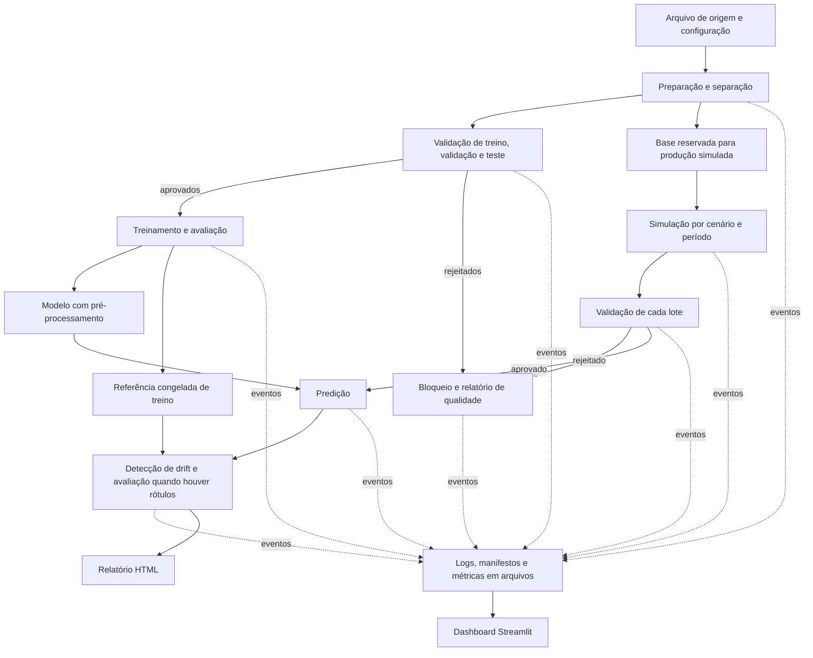

# Arquitetura e contratos entre componentes

## Estado e escopo

Este documento define a arquitetura e os contratos entre componentes do
pipeline. Os componentes, comandos e arquivos de saída descritos aqui ainda
não foram implementados nem validados funcionalmente.

A arquitetura é um pipeline local em lote, com Python 3.12, uv, arquivos como
interface e dashboard Streamlit. As dependências incluem pandas,
scikit-learn, Pandera e Evidently.

## Fluxo e responsabilidades

| Componente futuro em `src/monitoramento/` | Responsabilidade | Consome | Produz |
| --- | --- | --- | --- |
| `preparacao.py` | Ler a fonte autorizada, executar transformações determinísticas e separar partições | Arquivo de origem e configuração do dataset | Treino, validação, teste, base de simulação e manifesto de preparação |
| `validacao.py` | Aplicar o contrato Pandera e bloquear o conjunto inteiro quando inválido | Manifesto do conjunto e versão do contrato | Relatório de qualidade e manifesto de aprovação ou rejeição |
| `treinamento.py` | Ajustar pré-processamento e classificador no treino; selecionar pela validação; avaliar no teste após seleção | Partições aprovadas e configuração do modelo | Pipeline serializado, metadados, métricas de avaliação e referência |
| `simulacao.py` | Produzir lotes independentes, com cenário de controle e mudanças configuradas | Base de simulação, cenário e seed | Lotes por período e manifesto de cada cenário |
| `predicao.py` | Aplicar o mesmo pipeline do treinamento | Lote aprovado e manifesto do modelo | Predições e manifesto com vínculos ao modelo e lote |
| `deteccao.py` | Comparar referência e lote com Evidently; avaliar desempenho somente com rótulos compatíveis | Referência, lote aprovado, predições e configuração de detecção | Resultados estatísticos, alertas e HTML |
| `dashboard.py` | Apresentar execuções e resultados persistidos, inclusive falhas | Manifestos, eventos, métricas agregadas e relatórios | Visualização Streamlit; sem iniciar treino ou alterar os dados |

A validação se aplica antes de qualquer ajuste ou predição. A preparação não
aprende imputação, escalas, codificações ou seleção de variáveis a partir do
conjunto completo. Se não puder ler ou separar a origem com segurança, deve
falhar e registrar o erro, sem gerar aprovação implícita.

## Separação dos dados e prevenção de vazamento

| Papel | Caminho futuro | Uso permitido |
| --- | --- | --- |
| Treino | `data/reference/<preparation_id>/train.csv` | Ajuste do pipeline e origem da referência estatística |
| Validação | `data/reference/<preparation_id>/validation.csv` | Seleção do modelo; sem ajuste do pré-processamento |
| Teste | `data/reference/<preparation_id>/test.csv` | Avaliação final, após a seleção |
| Referência de drift | `data/reference/<reference_id>/features.csv` | Cópia congelada das features de treino na representação de entrada do modelo |
| Base de simulação | `data/analysis/<preparation_id>/simulation_base.csv` | Origem reservada dos cenários; fora de treino, validação e teste |
| Produção simulada | `data/analysis/<scenario_id>/<batch_id>/features.csv` | Validação, predição e comparação com a referência |
| Rótulos de produção, quando disponíveis | `data/analysis/<scenario_id>/<batch_id>/labels.csv` | Avaliação posterior; não entram como features |

As quatro partições devem ser disjuntas. Estratégia de divisão, proporções,
estratificação, agrupamento ou corte temporal dependem do dataset e da decisão
da equipe. Sua configuração e seed devem constar no manifesto. Nenhuma
proporção está definida.

O alvo não participa dos testes de drift das features. Identificadores de
linha servem somente ao alinhamento, não ao ajuste do modelo ou à detecção.
A referência fica congelada durante o experimento; alterar o treino ou sua
representação exige novo `reference_id` e registro de compatibilidade com o
modelo. Os cenários nunca sobrescrevem a referência nem a base de simulação.

Treino, validação e teste contêm `record_id`, features e alvo. A referência
e os lotes de entrada contêm `record_id` e features; `labels.csv` contém
`record_id` e a coluna alvo definida no schema. Campos técnicos são removidos
da matriz de features. `preparation_id` identifica a execução de preparação;
IDs de cenário, lote, modelo e referência são novos quando seus artefatos
mudam, evitando sobrescrita nos caminhos de dados e modelos.

## Contratos de arquivos e execução

### Convenções comuns

- Tabelas: CSV UTF-8, separador vírgula, cabeçalho obrigatório, sem índice
  implícito e decimais com ponto. Campo vazio representa ausência; strings
  vazias válidas exigem revisão explícita do contrato. Os tipos são definidos
  pelo schema, sem depender apenas da inferência do leitor CSV.
- Metadados, configurações e resultados agregados: JSON UTF-8. Eventos:
  JSON Lines UTF-8, um objeto por linha. Datas: ISO 8601 em UTC.
- Todos os caminhos nos manifestos são relativos à raiz do projeto. Cada
  execução recebe um `run_id` único; cada conjunto tem `dataset_id`. IDs
  técnicos não podem conter PII nem ser derivados de identificadores pessoais.
- `record_id` é uma string técnica única, criada antes da separação e
  preservada nos cenários. Duplicidade entre períodos deve ser distinguida
  pelo `batch_id`; o alinhamento usa o par `batch_id`, `record_id`.
- O contrato de negócio define nomes, ordem e tipos de features, alvo,
  classe positiva, categorias e regras. Esses itens permanecem pendentes.
  Schema incompatível bloqueia o consumo; não se renomeiam ou descartam
  colunas silenciosamente.
- Cada etapa referencia `config.json` com os parâmetros efetivos e seed
  quando aplicável. Configurações e logs não contêm credenciais ou registros.
- Saídas são gravadas em diretório novo por execução. O manifesto terminal
  é publicado por último; consumidores só usam artefatos declarados nele.
  Reexecuções recebem novo ID e não sobrescrevem resultados anteriores.

### Manifesto comum

Cada etapa produz `reports/runs/<run_id>/manifest.json`. Campos obrigatórios:

| Campo | Tipo e significado |
| --- | --- |
| `contract_version` | String; versão inicial `1.0` para a estrutura das interfaces |
| `run_id` | String; identificador da execução da etapa |
| `stage` | Enum: `preparacao`, `validacao`, `treinamento`, `simulacao`, `predicao`, `deteccao` |
| `status` | Enum terminal: `success`, `rejected`, `failed`, `skipped` |
| `started_at`, `finished_at` | Strings ISO 8601 UTC |
| `config_path` | String; configuração efetivamente utilizada |
| `inputs` | Lista de objetos com `artifact_type`, `path`, `sha256` e `producer_run_id`; este último pode ser nulo para a origem externa |
| `outputs` | Lista com a mesma estrutura; `producer_run_id` é a execução atual |
| `dataset_id` | String ou nulo para etapa sem um único conjunto |
| `schema_version` | String ou nulo antes da definição do schema de negócio |
| `model_id`, `reference_id`, `scenario_id`, `batch_id` | Strings ou nulos quando não aplicáveis |
| `error_code` | String técnica sanitizada; nulo em sucesso |

Arquivos tabulares também informam `row_count` inteiro e `columns` como lista
ordenada de strings no objeto de artefato. O hash identifica o arquivo exato;
a aprovação de qualidade vale para aquele hash e `schema_version`.
Mudanças incompatíveis exigem aumento da versão principal do contrato.
Consumidores rejeitam versões principais desconhecidas.

O manifesto da validação mantém o CSV verificado em `inputs` e publica o
relatório de qualidade em `outputs`; não duplica nem reescreve o dataset.
O consumidor resolve o CSV pelo manifesto aprovado e confere novamente o
hash. `schema_version` é obrigatoriamente não nulo para aprovação de dados
e para as etapas que consomem dados aprovados.

Uma etapa dependente exige `success` no produtor e verifica existência,
hash, schema e IDs compatíveis antes de consumir. Resultados parciais de
`failed` ou `rejected` servem apenas ao diagnóstico. Dependências bloqueadas
geram evento `skipped`, sem predições ou métricas de desempenho fictícias.

### Interface dos scripts

Na implementação, cada módulo de processamento deverá aceitar:

| Argumento | Contrato |
| --- | --- |
| `--config` | Caminho do JSON de configuração da etapa |
| `--input-manifest` | Caminho de manifesto de entrada; repetível para múltiplas dependências |
| `--run-id` | Identificador novo da execução |
| `--output-dir` | Diretório novo `reports/runs/<run_id>/` |

Na preparação, o arquivo de origem é indicado em `--config`; não há
manifesto produtor para essa origem. Os manifestos das partições aprovadas
são passados ao treinamento. A configuração identifica o papel de cada
entrada pelo `dataset_id`, sem depender da ordem dos argumentos.

Código de saída: `0` para sucesso, `2` para rejeição de qualidade e `1` para
erro técnico, configuração inválida ou incompatibilidade de artefatos.
O executor futuro registra etapas dependentes como `skipped` quando uma
dependência não tiver sucesso. Um alerta de drift não é erro de execução:
uma detecção concluída com alerta termina em `success`.

O dashboard terá entrada própria `--runs-dir`, apontando para
`reports/runs/`. Esses argumentos são um contrato futuro, não comandos
disponíveis para execução agora.

### Saídas específicas por etapa

| Etapa | Artefatos e campos adicionais obrigatórios |
| --- | --- |
| Preparação | Partições CSV; manifesto com fonte e licença quando definidas, hash de origem, estratégia de separação, seed, papéis das partições e transformações determinísticas |
| Validação | `quality.json`: `dataset_id`, `schema_version`, `approved` booleano, `checked_rows` inteiro e `violations` com `rule_id` e `count`; sem valores ou linhas rejeitadas |
| Treinamento | `models/<model_id>/pipeline.pkl`, `metadata.json` e `evaluation.json`; metadados com lista ordenada de features, alvo, classe positiva, versões do ambiente, seed, partições de origem e `reference_id`; avaliação com nome, valor, partição e número de rótulos válidos por métrica |
| Simulação | Features CSV; manifesto com `scenario_id`, `batch_id`, período, base de origem, seed, variáveis alteradas, transformações e parâmetros; rótulos em arquivo separado, se existirem |
| Predição | `data/analysis/<scenario_id>/<batch_id>/<model_id>/predictions.csv`, com `record_id`, `prediction` e `score` numérico ou vazio; manifesto informa se `score` está disponível e seu significado; sem probabilidade inventada para modelos que não a forneçam |
| Detecção | `drift.json` e `drift.html` em `reports/runs/<run_id>/`; resultados por variável com `feature`, `method`, `statistic`, `threshold` e `drift_detected`; métricas de desempenho, quando calculáveis, em `performance.json` |
| Todas as etapas | `config.json`, `events.jsonl`, `metrics.json` e `manifest.json` em `reports/runs/<run_id>/` |

O pipeline serializado inclui o pré-processamento ajustado e o classificador.
Seu carregamento fica restrito a artefatos produzidos e confiáveis da equipe;
o formato não torna seguro carregar objetos de fontes desconhecidas.

Predições têm correspondência um a um com o lote, sem IDs ausentes ou extras.
A classe prevista usa o domínio do alvo definido no schema. O significado
de `score` e a classe associada são registrados nos metadados do modelo.
Rótulos reais, quando disponíveis, exigem alinhamento verificado por ID,
origem e período; ausência de rótulos é `not_available`, nunca desempenho zero.

Os testes e limiares de drift devem ser aprovados e explícitos na configuração
antes da execução. O resultado identifica também versões da ferramenta,
modelo, referência e lote, tamanhos das amostras e parâmetros efetivos.
Uma variável não avaliável registra motivo e valores nulos, sem converter
ausência de evidência em `drift_detected: false`.

## Qualidade, cenários e significado dos alertas

O contrato Pandera terá pelo menos três regras rígidas de qualidade, conforme
o enunciado. Regras concretas, limites e colunas serão definidos após a escolha
do dataset. Uma violação rejeita o lote inteiro e impede treino ou predição;
o relatório registra contagens e códigos sanitizados. Não há correção
silenciosa nem descarte automático de registros para obter aprovação.

Os cenários devem separar:

- Controle, sem alteração intencional da distribuição.
- Lote inválido, destinado a demonstrar bloqueio de qualidade.
- Data Drift, com mudança configurada em pelo menos duas variáveis
  importantes, mantendo as regras rígidas quando o objetivo for chegar à
  detecção. Isso separa uma rejeição de qualidade de um alerta estatístico.
- Concept Drift, com mudança explicitamente definida na relação entre
  entradas e alvo. O desenho e a disponibilidade de rótulos estão pendentes;
  mudar features ou apenas inverter rótulos sem justificativa não demonstra,
  por si só, esse fenômeno no problema de negócio.

Data Drift, Concept Drift e queda de desempenho são resultados distintos.
O dashboard deve apresentar cada evidência com seu contexto. Mudança de
distribuição não comprova degradação do modelo nem causalidade. Dados e
rótulos simulados são identificados como simulação em todos os relatórios.

## Observabilidade escolhida

**Estratégia de observabilidade definida: dashboard Streamlit, com eventos JSONL e métricas
exportadas em JSON, acompanhados dos relatórios HTML do Evidently.**
A justificativa é aproveitar o setup existente, permitir leitura de resultados
locais e atender à alternativa de dashboard interativo do enunciado, sem
adicionar um serviço de rastreamento. MLflow não integra a arquitetura base.

Cada etapa usa o mesmo contrato de evento: `timestamp`, `run_id`, `stage`,
`event`, `level`, `dataset_id`, `model_id`, `reference_id`, `scenario_id`,
`batch_id` e `error_code`. IDs não aplicáveis e erro ausente são nulos.
`event` admite `started`, `completed`, `rejected`, `failed`, `skipped` e
`drift_alert`; `level` admite `INFO`, `WARNING` e `ERROR`. A validação inclui
eventos de falha mesmo quando nenhum artefato de dados for aprovado.

Cada `metrics.json` contém `run_id` e lista `measurements`, com objetos
`name`, `value`, `unit` e `availability`. `value` é número ou nulo;
`availability` é `available`, `not_available` ou `not_applicable`.

O catálogo abaixo apresenta medidas candidatas de monitoramento. A interface
e o caminho de exportação estão definidos; a seleção das métricas e de seus
limiares permanece pendente:

| Categoria | Medidas candidatas | Apresentação esperada |
| --- | --- | --- |
| Pipeline | Status por etapa, duração e volume processado | Histórico por execução e etapa; distinção de falha, rejeição e sucesso |
| Qualidade | Lotes rejeitados e violações por regra | Alertas de bloqueio e vínculo ao relatório de qualidade |
| Drift | Resultados por variável e quantidade de alertas | Referência, cenário, período, método e limiar visíveis |
| Modelo | Métricas de classificação escolhidas pelo grupo | Valor com modelo, partição, período e cobertura de rótulos |
| Infraestrutura local | Espaço livre para artefatos e capacidade de persistir saídas | Diagnóstico de indisponibilidade e erros de escrita, sem confundir com drift |

O dashboard lê os diretórios de execução, consolida eventos por ID e oferece
filtros por etapa, cenário e lote. Exibe origem e horário da última atualização,
estado vazio quando não houver execuções e aviso para resultados incompletos.
Execução iniciada sem evento terminal é apresentada como incompleta, sem
inferir sucesso. Um manifesto inválido ou relatório ausente deve aparecer
como indisponível e não impedir a exibição dos outros resultados.

Logs não incluem amostras de linhas, features individuais, PII ou credenciais.
Relatórios HTML devem ser revisados antes de compartilhamento: ferramentas
de relatório podem incluir valores e categorias do dataset. O dashboard
prioriza resultados agregados e referências a artefatos locais.
O prazo de retenção e a revisão de privacidade permanecem na governança.

## Artefatos, persistência e implementação futura

Os caminhos são contratos planejados; os diretórios de execução, datasets
e modelos serão gerados pelos componentes do pipeline. Dados ficam em
`data/reference/` e `data/analysis/`, e modelos em `models/`, conforme as
exclusões atuais.
`reports/` não possui exclusão geral no setup: logs, configurações e relatórios
não devem ser publicados automaticamente. A equipe deve revisar seu conteúdo
e definir retenção e eventual exclusão antes de produzi-los ou compartilhá-los.

Nenhuma etapa usa bancos de dados. A execução local futura será documentada
quando os módulos existirem. Automação, API de serving, nuvem e retreinamento
automático exigem decisão posterior de escopo.

## Definições pendentes e validação funcional

Pendências para implementação: dataset e licença; schema de negócio;
estratégia de separação; algoritmo; métricas operacionais e de classificação;
três ou mais regras de qualidade; cenários e rótulos; testes estatísticos,
limiares e janelas; governança e retenção. Esses itens não impedem a definição
das interfaces, mas impedem tratar o pipeline como pronto para execução.

A validação funcional do pipeline deverá demonstrar aprovação de dados
válidos, rejeição do lote inválido, isolamento das partições, alinhamento
de predições, reprodução dos cenários,
relatório de drift e exibição de sucesso, bloqueio e falha no dashboard.

### Configuracao invalida e inicio da execucao

A configuracao e validada antes da criacao do diretorio de uma execucao. Se for invalida, o comando termina com codigo 1 e mensagem controlada; como a execucao ainda nao iniciou, nao cria `run_id`, eventos nem manifesto. Depois que o diretorio da execucao e criado, falhas tecnicas ao ler ou preparar a origem sao registradas em eventos e manifesto terminal sempre que a persistencia estiver disponivel.
