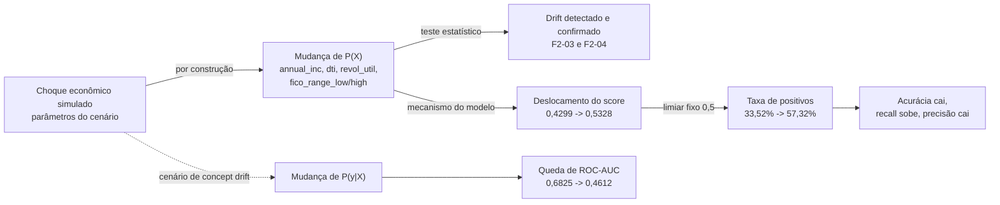

# Análise causal da degradação — F4-03

Documento da issue F4-03: relacionar as mudanças econômicas simuladas, o drift
detectado e o comportamento do modelo, formulando **hipóteses causais
explícitas** sem tratar correlação como prova causal. Complementa a
[governança de dados](LGPD.md) (F4-01) e a [análise de vieses](VIESES.md)
(F4-02).

O cenário de drift é **simulado**: as cadeias abaixo valem dentro do experimento,
não são afirmações sobre a economia real nem sobre uma recessão observada.

## 1. Escopo e método

| Item | Definição |
|---|---|
| Modelo | `baseline-logreg-820dbb61` — regressão logística, limiar 0,5, sem retreino |
| Cenário de data drift | `data-drift` / lote `batch-f201` ([configs/simulacao.json](../configs/simulacao.json)) |
| Cenário de concept drift | `concept-drift` / lote `batch-f205` ([configs/simulacao_concept.json](../configs/simulacao_concept.json)) |
| Detecção | `run-f203-deteccao` ([drift.json](../reports/runs/run-f203-deteccao/drift.json)) |
| Análise estatística | `run-f204-analise` ([analise.json](../reports/runs/run-f204-analise/analise.json)) |
| Predição | `run-f202-predicao` ([metrics.json](../reports/runs/run-f202-predicao/metrics.json)) |
| Avaliação de conceito | `run-f205-avaliacao` ([performance.json](../reports/runs/run-f205-avaliacao/performance.json)) |

**Desenho de contraste controlado.** Os dois cenários partem das mesmas 10.000
linhas da base reservada (`simulation_base.csv`) e preservam `record_id`:

- no **data drift**, as linhas são as mesmas e apenas as features são
  transformadas (o rótulo não muda);
- no **concept drift**, as linhas e as features são as mesmas e apenas o rótulo
  muda.

Isso permite comparar o modelo **antes e depois** sobre exatamente os mesmos
registros, isolando o efeito de cada mudança — o que uma comparação entre
partições distintas não permitiria.

**Análise adicional executada para este documento.** As métricas de desempenho
sob data drift e a decomposição da variação do score não existem em artefato
próprio: foram calculadas aqui a partir dos artefatos persistidos (features,
rótulos e pipeline), sem retreinar. O procedimento consta do Apêndice.

## 2. Cadeia causal do cenário



A seta `B → C` é uma **verificação estatística** (as distribuições diferem), não
uma prova de causa. A seta `B → D` é o **mecanismo do modelo**: features
diferentes entram na mesma função e produzem scores diferentes. A seta
`D → F` é um **efeito de limiar**, discutido na Seção 4.

## 3. Hipóteses causais explícitas

| # | Hipótese | Evidência | Veredito |
|---|---|---|---|
| H1 | A alteração econômica injetada causou a mudança de distribuição das cinco features. | A simulação aplica transformação determinística sobre as mesmas linhas; as 5 variáveis configuradas estão entre as confirmadas por PSI/K-S (F2-04, `confirmed == configured`); as médias batem com os parâmetros do cenário. | **Sustentada** (por construção e confirmada) |
| H2 | A mudança de P(X) deslocou o score e a taxa de positivos. | Contraste controlado: score médio 0,429862 → 0,532785; taxa de positivos 33,52% → 57,32%. A decomposição atribui ~99,9% da variação do log-odds às cinco features alteradas. | **Sustentada** |
| H3 | A mudança de P(y|X) causou a queda de ROC-AUC no cenário de concept drift. | Features e scores **idênticos**; apenas 1.916 rótulos mudaram (taxa positiva 0,195 → 0,3866); ROC-AUC 0,6825 → 0,4612. | **Sustentada** |
| H4 | O data drift, por si só, degradou o poder discriminativo do modelo. | ROC-AUC 0,682481 → 0,682221 e F1 0,393814 → 0,393387, com os mesmos rótulos; apenas as features mudaram. | **Refutada** |
| H5 | A queda de acurácia observada sob data drift é efeito do limiar fixo, não perda de informação do modelo. | Recall 0,5354 → 0,7749 e precisão 0,3115 → 0,2636, com ROC-AUC e F1 praticamente iguais. | **Sustentada** |
| H6 | A recessão simulada representa uma recessão real. | O cenário é parametrizado por configuração; não há dados econômicos observados nem grupo de comparação externo. | **Não testável** |

## 4. Mudanças e resultados relacionados ao modelo

### 4.1 Mudança injetada e confirmada (F2-01 → F2-03 → F2-04)

| Variável | Operação | Média antes → depois |
|---|---|---|
| `annual_inc` | escala 0,80 | 78.694,91 → 62.970,37 |
| `revol_util` | escala 1,35 | 41,97 → 56,67 |
| `dti` | deslocamento +6,0 | 18,67 → 24,62 |
| `fico_range_low` | deslocamento −25,0 | 704,70 → 679,69 |
| `fico_range_high` | deslocamento −25,0 | 708,70 → 683,70 |

A detecção (Evidently) classificou **13 de 22** variáveis com drift (proporção
0,590909); a análise estatística (PSI/K-S) classificou **8 de 22** (0,363636,
PSI máximo 0,719465). Os dois métodos **concordam** nas cinco variáveis
alteradas, e o conjunto maior da detecção inclui variáveis não injetadas — os
métodos têm sensibilidades diferentes, o que reforça que um único limiar não
define causa.

### 4.2 Efeito no comportamento do modelo (contraste controlado)

| Medida | Original | Após transformação | Variação |
|---|---|---|---|
| Score médio | 0,429862 | 0,532785 | +0,102923 |
| Taxa de positivos (limiar 0,5) | 33,52% | 57,32% | +23,80 p.p. |
| Log-odds médio | — | — | +0,475842 (razão de chances ≈ 1,61) |

A taxa de positivos de 57,32% e o score médio de 0,532785 reproduzem os valores
registrados em [metrics.json](../reports/runs/run-f202-predicao/metrics.json),
o que valida o contraste.

**Decomposição da variação do log-odds** (contribuição de cada feature
padronizada, ou seja, `coeficiente × valor`):

| Feature | Δ log-odds | Participação |
|---|---|---|
| `dti` | +0,160520 | 33,7% |
| `fico_range_high` | +0,146243 | 30,7% |
| `fico_range_low` | +0,146088 | 30,7% |
| `annual_inc` | +0,038110 | 8,0% |
| `revol_util` | −0,015118 | −3,2% |

Três leituras:

- O aumento de risco vem majoritariamente de `dti`, `fico_range_low` e
  `fico_range_high`, coerentes com o sinal econômico esperado (mais
  comprometimento de renda e menor score elevam a inadimplência).
- `revol_util` contribui **negativamente** para o risco, porque o coeficiente
  aprendido para a variável é negativo (−0,0248). Isso contraria a leitura
  econômica de que maior utilização do crédito indica maior risco e é um
  sintoma do modelo simples, sem engenharia de atributos — o que limita a
  interpretação do mecanismo, embora não mude a conclusão sobre o deslocamento
  total do score.
- As cinco features alteradas explicam praticamente toda a variação (~99,9%),
  consistente com o fato de serem as únicas transformadas.

### 4.3 Desempenho sob data drift (mesmos rótulos, taxa positiva 19,5%)

| Métrica | Original | Features transformadas | Variação |
|---|---|---|---|
| acurácia | 0,6786 | 0,5340 | −0,1446 |
| precisão | 0,311456 | 0,263608 | −0,047848 |
| recall | 0,535385 | 0,774872 | +0,239487 |
| f1 | 0,393814 | 0,393387 | −0,000427 |
| roc_auc | 0,682481 | 0,682221 | −0,000260 |

O poder discriminativo (ROC-AUC) e o equilíbrio precisão/recall (F1) ficaram
**praticamente inalterados**. A queda de acurácia vem de o modelo sinalizar
muito mais registros com o limiar fixo de 0,5: recall sobe e precisão cai quase
na mesma proporção. Trata-se de **efeito de limiar/calibração**, não de perda de
capacidade de ordenação.

### 4.4 Desempenho sob concept drift

| Métrica | Conceito original | Cenário de concept drift | Variação |
|---|---|---|---|
| acurácia | 0,6786 | 0,5396 | −0,1390 |
| precisão | 0,311456 | 0,389916 | +0,078460 |
| recall | 0,535385 | 0,338076 | −0,197309 |
| f1 | 0,393814 | 0,362150 | −0,031664 |
| roc_auc | 0,682481 | 0,461174 | −0,221307 |

Aqui as features e os scores são **idênticos** entre os dois conceitos; o que
muda é o significado do rótulo. O ROC-AUC desaba e se aproxima de 0,5, o que
mostra que a ordenação do modelo perdeu validade — sem que o modelo tenha
mudado. É o contraste direto com o data drift: **mudar a distribuição das
entradas desloca o score; mudar a relação entrada–desfecho destrói a
capacidade preditiva**.

## 5. Limitações da inferência causal

- **Confundimento temporal.** A referência é a partição de treino e o lote é a
  base reservada, com `issue_d` deslocado em 24 meses. Parte das diferenças pode
  refletir a separação temporal — e não apenas a transformação injetada. O
  próprio relatório da F2-04 registra essa ressalva.
- **Choque simulado.** A causa "recessão" é um parâmetro de configuração, não um
  evento observado. As conclusões valem para o experimento, não para a economia
  real (H6).
- **Contrafactual assumido.** No data drift assume-se que o rótulo não muda com
  a transformação. Na prática, uma recessão real alteraria também P(y|X) — é
  exatamente o que o cenário de concept drift representa separadamente.
- **Amostra única, sem repetição.** Não foram usadas múltiplas sementes nem
  intervalos de confiança; os testes indicam diferença entre amostras, não
  tamanho de efeito com incerteza.
- **Sem identificação causal formal.** Não há DAG estimado, ajuste de
  confundidores nem inferência contrafactual; as hipóteses são avaliadas por
  contraste controlado e decomposição do modelo linear.
- **Mecanismo parcialmente implausível.** Coeficientes como o de `revol_util`
  contrariam a intuição econômica, o que limita a leitura do mecanismo interno.
- **Um modelo.** Tudo se refere ao `baseline-logreg-820dbb61`; outro modelo pode
  responder de forma diferente ao mesmo cenário.

## 6. Impactos e medidas corretivas

**Impactos observados.** Sob data drift, o modelo sinaliza 57,32% dos registros
contra 33,52% antes — se o score embasar decisão, isso significa muito mais
recusas e mais risco de negar crédito a bons pagadores. Sob concept drift, a
ordenação perde validade (ROC-AUC → 0,46) e o modelo passa a errar de forma
sistemática no segmento afetado, sem que nenhum alarme dispare apenas pela
distribuição das entradas.

| Medida corretiva | Ação | Justificativa |
|---|---|---|
| Recalibração do limiar | Reajustar o ponto de corte sob drift antes de decidir por retreino | H5: a queda de acurácia é efeito de limiar, não de perda de informação |
| Retreino condicionado | Retreinar apenas quando o ROC-AUC (ou F1) cair, não pelo simples alerta de drift | H4: drift de entrada não implica perda de poder discriminativo |
| Monitoramento de P(y|X) | Medir desempenho com rótulos, mesmo que atrasados, por período e por segmento | H3: concept drift só é visível com desfecho |
| Contraste controlado permanente | Repetir o desenho "mesmas linhas antes/depois" como rotina de diagnóstico | Separa efeito de composição de efeito real |
| Alerta sem alarmismo | Tratar `drift_alert` como sinal de investigação, não como falha | Já é o comportamento das etapas F2-03 e F2-04 |
| Revisão de features frágeis | Reavaliar coeficientes com sinal contrário ao esperado (ex.: `revol_util`) | Melhora a interpretabilidade do mecanismo |

## 7. Critérios de aceite (F4-03)

| Critério | Seção | Evidência |
|---|---|---|
| Hipóteses causais explícitas | 3 | H1–H6 com veredito e evidência |
| Mudanças e resultados estatísticos relacionados ao modelo | 4 | Contraste controlado, decomposição e tabelas de desempenho |
| Limitações de inferência causal reconhecidas | 5 | Confundimento temporal, choque simulado, contrafactual assumido, sem IC |
| Possíveis impactos e medidas corretivas documentados | 6 | Impactos por cenário e tabela de medidas |
| Conclusões sustentadas por evidências | 3, 4 | Números reproduzidos dos artefatos persistidos |

## 8. Insumos para o README (F4-04)

Texto sugerido para a consolidação:

> **Análise causal da degradação (F4-03).** As mudanças econômicas simuladas
> foram relacionadas ao drift detectado e ao comportamento do
> `baseline-logreg-820dbb61` por contraste controlado sobre as mesmas 10.000
> linhas. O data drift (`batch-f201`) deslocou o score médio de 0,4299 para
> 0,5328 e a taxa de positivos de 33,52% para 57,32%; a decomposição do
> log-odds atribui ~99,9% da variação às cinco features alteradas
> (`dti` 33,7%, `fico_range_high` 30,7%, `fico_range_low` 30,7%,
> `annual_inc` 8,0%, `revol_util` −3,2%). Com os **mesmos rótulos**, porém, o
> ROC-AUC e o F1 permaneceram estáveis (0,6825 → 0,6822 e 0,3938 → 0,3934):
> a queda de acurácia é **efeito do limiar fixo**, não perda de poder
> discriminativo. Já o concept drift (`batch-f205`) manteve features e scores
> idênticos e alterou 1.916 rótulos, derrubando o ROC-AUC de 0,6825 para 0,4612
> — mudança de P(y|X) destrói a validade da ordenação. Limitações incluem
> confundimento temporal, choque simulado e ausência de inferência causal
> formal. Detalhes em [docs/CAUSAL.md](docs/CAUSAL.md).

## 9. Pendências

- Repetir o contraste com múltiplas sementes e reportar intervalos de confiança.
- Medir a degradação com rótulos reais posteriores ao drift, quando existirem.
- Avaliar a recalibração do limiar em cenário de data drift (medida proposta na
  Seção 6) em componente próprio.
- Recalcular as conclusões caso o baseline seja retreinado.

## Referências

- [drift.json](../reports/runs/run-f203-deteccao/drift.json) — detecção (F2-03).
- [analise.json](../reports/runs/run-f204-analise/analise.json) — PSI/K-S e
  cruzamento com as variáveis configuradas (F2-04).
- [metrics.json](../reports/runs/run-f202-predicao/metrics.json) — predição
  sobre o lote simulado (F2-02).
- [performance.json](../reports/runs/run-f205-avaliacao/performance.json) —
  contraste de conceito (F2-05).
- [configs/simulacao.json](../configs/simulacao.json) e
  [configs/simulacao_concept.json](../configs/simulacao_concept.json) —
  parâmetros dos cenários.
- [docs/ARQUITETURA.md](ARQUITETURA.md) — contratos entre as etapas.

## Apêndice — como reproduzir

O contraste e a decomposição usam o pipeline persistido e as mesmas linhas dos
dois cenários, sem retreinar. Trecho essencial (executar na raiz do projeto):

```python
import json
from pathlib import Path

import numpy as np
import pandas as pd
from monitoramento.modelos.carregamento import carregar_pipeline

diretorio = Path("models/baseline-logreg-820dbb61")
meta = json.loads((diretorio / "metadata.json").read_text(encoding="utf-8"))
features = meta["features"]
pipeline = carregar_pipeline(diretorio / "pipeline.pkl")

def ler(caminho):
    return pd.read_csv(caminho, dtype=str, na_filter=False).replace("", np.nan)

origem = ler("data/analysis/lending_club_100k_v1/simulation_base.csv").set_index("record_id")
lote = ler("data/analysis/data-drift/batch-f201/features.csv").set_index("record_id")
lote = lote.loc[origem.index]  # mesmas linhas, mesma ordem

p_antes = pipeline.predict_proba(origem[features])[:, 1]
p_depois = pipeline.predict_proba(lote[features])[:, 1]

print(p_antes.mean(), (p_antes >= 0.5).mean())
print(p_depois.mean(), (p_depois >= 0.5).mean())
```

A decomposição do log-odds multiplica a saída do `preprocessamento` pelos
coeficientes do `classificador`, agrupando as colunas de one-hot pela feature de
origem. O desempenho sob data drift usa `data-drift/batch-f201/labels.csv`
(rótulos originais) contra os dois conjuntos de scores.
